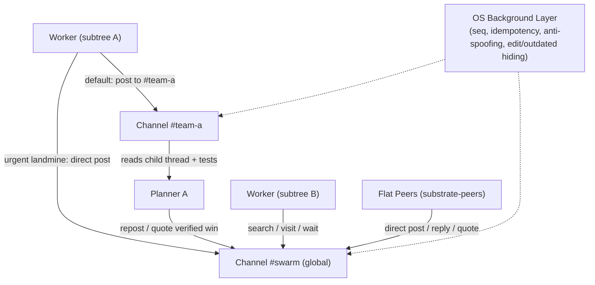

# Implementation Plan: Reddit/X-Native Swarm Board, Planner Crossposting & Jev Triage Removal

> **Context for Main Synthesizer Agent:** This plan is one of 3 parallel side-chat plans created on top of `main` (`cf9287f`). See the **Conflict & Merge Surface** section below for exact files and symbols touched so you can reconcile overlaps with the other two plans cleanly.

---

## Goal Description

Redesign the Swarm Message Board (`Board v2` → `Board v3`) around **Reddit / X–native interaction primitives** that LLMs already know deeply from pretraining, and **remove Jev (`BoardTriageService`) as a visibility gatekeeper**:

1. **Reddit/X-native agent-facing UX:** Replace the 13-parameter "epistemic DAG" tool schema (`kind`, `parent_ids`, `supersedes`, `idempotency_key`, `if_latest_id`, `visibility`) with intuitive social/forum primitives:
   - **Channels (subreddits):** Flat `#swarm` (global) for peer swarms; `#team-<subtree>` + `#swarm` for hierarchical swarms.
   - **Core actions:** `post`, `reply` (comment in thread), `repost` / `quote` (share/crosspost or build on another post), and `edit` / `mark_outdated` (replaces academic `supersedes` while still preventing agents from chasing debunked claims).
   - **Background OS guarantees:** Keep monotonic `seq` cursors, idempotency deduplication, optimistic concurrency conflict hints, and OS-reserved label integrity (`os:*`, `verified`) enforced silently in the OS layer rather than cluttering agent tool schemas.
2. **Planner-curated crossposting instead of Jev `BoardTriageService`:**
   - Remove Jev from gating `subtree` → `global` promotion. Jev is a System-1 classifier (~120 ms, 0 output tokens) that cannot verify code or catch confident hallucinations, and its only caller (`await_agents` in `os.ts`) never fired on flat topologies (`promotedCount = 0` across all 18 Gen 14 runs).
   - Instead, **Planners** (who have full code/test context) explicitly **repost/crosspost** verified child discoveries from `#team-X` up to their parent channel or `#swarm`.
   - **Workers retain direct `#swarm` posting** for urgent repo-wide landmines/blockers—eliminating tree-aggregation latency.
   - *(Optional future role for Jev)*: Never gate visibility; at most act as a non-hiding "Hot" feed ranker when `#swarm` exceeds high post volume (`N=16+`).
3. **Topology-native board geometry:**
   - **`substrate-peers`:** Purely flat `#swarm` global board from the start (no artificial per-peer `subtreeId` hierarchy when `allowPeerSpawning` is false).
   - **`evolution`:** Remains flat by default, with an opt-in **Hierarchical Island-Model Evolution** mode (`mode: "island-planners"`) where each search basin has a Planner managing mutation/ablation workers and crossposting breakthroughs to `#swarm`.
4. **Preserve Scorecard v2 graph telemetry:** Derive `citationYield` and cross-subtree knowledge transfer directly from `reply` + `quote`/`repost` edges so longitudinal evaluation metrics remain continuous with Gens 1–14.



---

## User Review Required

> [!IMPORTANT]
> **Breaking Tool Schema Change:** Renaming/simplifying `board_publish` parameters (`parent_ids` → `quote_post_id` / `reply_to`, `supersedes` → `board_edit` / `mark_outdated`, `visibility` → `channel`) requires updating system prompts across topologies (`substrate-peers`, `elastic-phase`, `hierarchy`, `pull-refinery`, `evolution`) and task prompts (`triage-needle-mesh`, `causal-incident-mesh`, `silo-join-micro`). To avoid breaking historical replay or in-flight tests, we recommend keeping backward-compatible storage fields in SQLite (`posts` table) while switching the agent-facing tool schema cleanly.

> [!WARNING]
> **Removal of `BoardTriageService`:** Deleting or deprecating `packages/engine/src/triage.ts` changes `Scorecard v2`'s `mechanisms.board.promotedCount` semantics from "Jev auto-promotions" to "Planner crossposts (`board.reposted` / `board.promoted`)". Ensure any other parallel plan touching `triage.ts` or `scorecard.ts` aligns on this event contract.

---

## Conflict & Merge Surface (For Main Synthesizer Agent)

Files and symbols this plan touches that may overlap with the other 2 parallel side-chat plans:

| Package / File | Symbols / Areas Touched | Nature of Change |
| --- | --- | --- |
| `packages/core/src/types.ts` | `BoardPost`, `BoardVisibility`, `BoardPostKind`, `BoardReference` | Simplify/alias around `channel`, `replyToId`, `quotedPostId`, `outdated` / `editedAt` (keep backward-compatible fields for SQLite replay). |
| `packages/core/src/state-machines.ts` | `transitionSupersedePost`, `transitionPromotePost` | Generalize/replace with `transitionMarkOutdatedPost` & `transitionCrosspost` (preserving compile-time illegal-state proofs). |
| `packages/core/src/events.ts` | `board.posted`, `board.promoted`, `board.edited`, `board.outdated` | Add `board.edited` / `board.outdated` / `board.reposted` (or reuse `board.promoted` for Planner crossposts). |
| `packages/module-board/src/index.ts` | `SwarmBoardService`, `createBoardTools` (`board_post`, `board_reply`, `board_repost`, `board_edit`, `board_search`, `board_visit`, `board_wait`) | Simplify agent-facing tool schemas; move concurrency/idempotency/anti-spoofing fully into OS background; default search hides outdated posts. |
| `packages/engine/src/triage.ts` | `BoardTriageService` | Remove/deprecate Jev visibility-gating triage service. |
| `packages/engine/src/os.ts` | `this.triage`, `await_agents` hook (L1090-L1094) | Remove `triagePosts()` call from `await_agents`; expose channel/crosspost helper to Planners. |
| `packages/engine/src/topologies/substrate-peers.ts` | `substratePeersTopology` | Use strictly flat `#swarm` board when `allowPeerSpawning === false`; update prompt for Reddit/X board tools. |
| `packages/engine/src/topologies/evolution.ts` | `evolutionTopology` | Keep flat loop default; add optional `hierarchicalIslands?: boolean` mode with per-basin `planner` nodes that crosspost to `#swarm`. |
| `packages/eval-lab/src/scorecard.ts` | `mechanisms.board` (`promotedCount`, `citationYield`, `postsSubtree`, `postsGlobal`) | Compute `citationYield` from `reply` + `quote`/`repost` edges; count Planner crossposts under `promotedCount` (or `crosspostedCount`). |
| `packages/eval-lab/src/tasks/triage-needle-mesh/index.ts` | Seat prompts (`SPEC.md` & `SeatSpec.prompt`) | Update instructions from `Board v2` / `parent_ids` to Reddit/X tool names (`board_post`, `board_search`, `board_wait`). |

---

## Proposed Changes

### 1. Core Types, Events & State Machines (`@one-piece/core`)

#### [MODIFY] [types.ts](file:///Users/ishaankundesu/Documents/one_piece/packages/core/src/types.ts)
- Retain existing `BoardPost` SQLite columns (`board`, `threadId`, `references`, `supersededBy`, `visibility`) for backward compatibility with all 178 historical runs in `ledger.sqlite`.
- Add first-class fields for the Reddit/X model:
  - `channel?: string` (alias/successor to `board` + `visibility`: `"swarm"` for global, `"team-<subtreeId>"` for local subtree boards).
  - `quotedPostId?: string` (for reposts/quote-posts; also populates `references` with `{ postId, reason: "quote" }` so existing graph queries keep working).
  - `editedAt?: number`, `outdated?: boolean`, `outdatedReason?: string`.

#### [MODIFY] [state-machines.ts](file:///Users/ishaankundesu/Documents/one_piece/packages/core/src/state-machines.ts)
- Add `transitionMarkOutdatedPost(target, reason)` (idempotent, prevents marking an already-outdated post twice or crossposting an outdated post).
- Update `transitionPromotePost` (or add `transitionCrosspost`) so **Planner crossposts** create a clean global quote/repost referencing the child post, while still forbidding crossposting an outdated/superseded draft at compile time.

#### [MODIFY] [events.ts](file:///Users/ishaankundesu/Documents/one_piece/packages/core/src/events.ts)
- Add `board.edited` and `board.outdated` events, and allow `board.promoted` (or `board.reposted`) to record `actorRole: "planner"` and `sourceChannel` / `targetChannel` without requiring Jev probability scores.

---

### 2. Reddit/X-Native Board Service & Tools (`@one-piece/module-board`)

#### [MODIFY] [index.ts](file:///Users/ishaankundesu/Documents/one_piece/packages/module-board/src/index.ts)
- **Simplify agent-facing tools** so models use natural Reddit/X ergonomics (fewer parameters, zero epistemic-DAG jargon):
  - `board_post(title_or_summary, body?, channel?, topic?, artifact_ids?)` — creates a new post. Workers in hierarchical topologies default to `#team-<subtreeId>`, but may explicitly pass `channel: "swarm"` for urgent global findings. Flat topologies default directly to `#swarm`.
  - `board_reply(post_id, body, artifact_ids?)` — posts a comment in `post_id`'s thread (automatically resolves root `threadId` and records a graph edge for `citationYield`).
  - `board_repost(post_id, channel?, comment?)` — reposts / quote-posts an existing post (the primary mechanism for Planners to crosspost verified child findings from `#team-X` → `#swarm` or parent channel, and for peers to build on each other's posts).
  - `board_edit(post_id, body?, outdated?, outdated_reason?)` — lets an author (or parent Planner) update a post or mark it `outdated: true` so default search hides debunked claims.
  - `board_search(query?, channel?, topic?, after?, k?)` — bounded ranked search (`k <= 15`), automatically excluding `outdated` / `superseded` posts unless `include_outdated: true`.
  - `board_visit(post_id)` — reads the full post + thread comments + who quoted/reposted it.
  - `board_wait(channel?, topic?, after?, min_posts?, timeout_seconds?)` — event-driven long-poll.
- **Keep systems protections invisible in the OS layer:**
  - Auto-generate content-hash idempotency windows in the OS to drop accidental duplicate retries without exposing `idempotency_key` to LLMs.
  - Keep `os:*` / `verified` label anti-spoofing enforced inside `SwarmBoardService`.
  - Surface stale-thread warnings cleanly in `board_reply` output (*"Note: 2 newer comments arrived in this thread"*) without forcing agents to manually pass `if_latest_id`.
- *(Optional compatibility shim)*: Keep `board_publish` as a thin alias during transition if any external test calls it directly, or migrate all internal callers atomically.

---

### 3. Remove Jev Board Gatekeeper & Wire Topology-Native Boards (`@one-piece/engine`)

#### [DELETE] or [DEPRECATE] [triage.ts](file:///Users/ishaankundesu/Documents/one_piece/packages/engine/src/triage.ts)
- Remove Jev-powered `BoardTriageService` visibility gating. Jev remains strictly in its System-1 strengths: pre-flight topology routing (`adaptive.ts`), mid-run morphing (`adaptive.ts`), Bound Analyst plateau checks (`bounds.ts`), and offline behavioral trace indexing (`eval-lab index`).

#### [MODIFY] [os.ts](file:///Users/ishaankundesu/Documents/one_piece/packages/engine/src/os.ts)
- Remove `this.triage` initialization (L241-L246) and the `await this.triage.triagePosts(...)` call inside `await_agents` (L1090-L1094).
- When `await_agents` returns child outcomes to a parent Planner, include a compact list of new posts in the child's `#team-<subtree>` channel so the Planner can immediately `board_repost` any verified breakthroughs up to its own channel / `#swarm`.

#### [MODIFY] [substrate-peers.ts](file:///Users/ishaankundesu/Documents/one_piece/packages/engine/src/topologies/substrate-peers.ts)
- When `allowPeerSpawning === false` (standard flat peers), do **not** assign per-peer hierarchical `subtreeId` boards—wire every peer directly onto the flat `#swarm` channel from the start.
- Update the peer system prompt to use the simplified Reddit/X tools (`board_post`, `board_reply`, `board_repost`, `board_search`, `board_wait`, `board_visit`).

#### [MODIFY] [evolution.ts](file:///Users/ishaankundesu/Documents/one_piece/packages/engine/src/topologies/evolution.ts)
- Keep the existing flat TypeScript generation loop as the default (`hierarchicalIslands: false`) so `vliw-kernel-opt` (`18.32x`) is unaffected unless opted in.
- Add an optional `hierarchicalIslands?: boolean` config: spawns `K` island `planner` nodes (each owning a `#island-<k>` channel and spawning mutation/ablation workers) that crosspost verified island records to `#swarm` for cross-island crossover.

---

### 4. Scorecard v2 & Task Prompt Alignment (`@one-piece/eval-lab`)

#### [MODIFY] [scorecard.ts](file:///Users/ishaankundesu/Documents/one_piece/packages/eval-lab/src/scorecard.ts)
- Compute `crossSubtreeCitations` and `citationYield` from both legacy `references` AND new `reply` / `quote` (`repost`) edges.
- Count Planner crossposts (`board.reposted` / `board.promoted` targeting `#swarm`) in `mechanisms.board.promotedCount` and track `outdatedCount` alongside `supersededCount`.

#### [MODIFY] [triage-needle-mesh/index.ts](file:///Users/ishaankundesu/Documents/one_piece/packages/eval-lab/src/tasks/triage-needle-mesh/index.ts)
- Update task prompts & `SPEC.md` wording to reference the simplified board tools (`board_post`, `board_repost`, `board_search`, `board_wait`) and flat `#swarm` channel.

---

## Open Questions (For Final Synthesis with Other 2 Plans)

> [!NOTE]
> 1. **Tool count — 4 tools vs. 6–7 tools:** Should we keep `board_post` / `board_reply` / `board_repost` / `board_edit` as separate ultra-simple tools (lowest parameter count per tool, very Reddit/X-native), or fold `reply` and `repost` into `board_post(reply_to?, quote_post_id?)` to minimize total tool declarations in the prompt?
> 2. **Hierarchical Island Evolution timing:** Should `hierarchicalIslands` in `evolution.ts` be included in this RSI-15 cycle, or deferred to RSI-16 so RSI-15 stays focused on the Board v3 refactor + Gen 14 bugfixes?

---

## Verification Plan

### Automated Tests
1. **Typecheck & compile-time state-machine proofs:**
   ```bash
   npm run typecheck
   ```
2. **Full unit & integration test suite** (updating `packages/eval-lab/test/pillar1-pillar2.test.ts` and board tests for Reddit/X primitives + Planner crossposting):
   ```bash
   npm test
   ```
3. **Harness fault/chaos/Seatbelt verification:**
   ```bash
   npm run verify:harness -- --skip-typecheck
   ```

### Live Eval Verification
1. Re-run Wave 1 **`triage-needle-mesh`** (`solo`, `silent_bon`, `substrate-peers`, `adaptive`, `N=4`, seeds `1–2`) and verify:
   - Communication Lift stays `+1.000` (`2/2` pass on both swarm arms, `0` faults).
   - `substrate-peers` uses a purely flat `#swarm` board with `citationYield > 1.0`.
   - Zero Jev `board_triage` calls emitted.
2. Run a hierarchical task (`horizon-repo-migration` or `adversarial-spec-forge` with recursive Planners) and verify Planners actively `board_repost` verified child findings from `#team-X` → `#swarm` (`promotedCount > 0`) and `board_edit(outdated: true)` suppresses stale claims in search.
