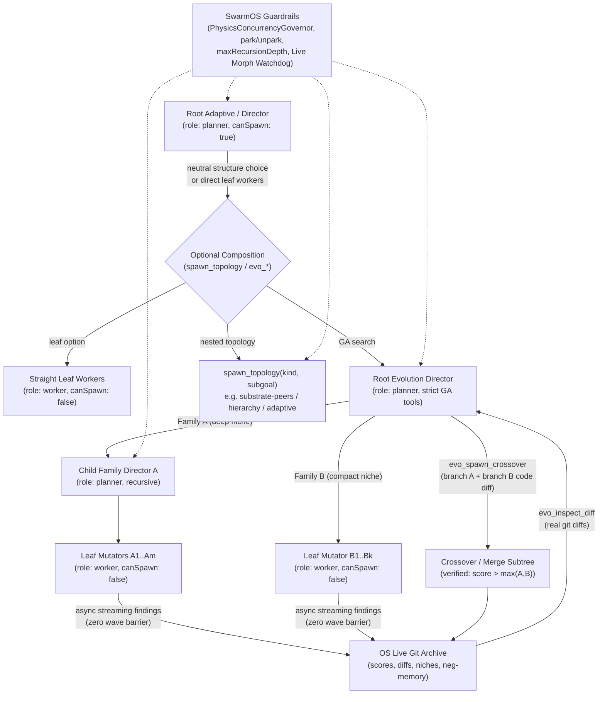

# Implementation Plan: Director-Led Recursive GA Evolution, Composable Recursive Topologies & Unbiased Adaptive Routing

> **Context for Main Synthesizer Agent:** This plan is one of 3 parallel side-chat plans created on top of `main` (`cf9287f`). It pairs directly with sibling plans in `docs/plans/` (including `board-v3-reddit-native-and-planner-crosspost.md`). See the **Conflict & Merge Surface** section below for exact overlapping files/symbols and explicit reconciliation notes so you can merge all 3 plans cleanly into one unified RSI-15/v4 specification.

---

## Goal Description

Fix the three root architectural weaknesses surfaced by Gen 14 (`cf9287f`) traces across `vliw-kernel-opt` and `horizon-repo-migration`, and establish two universal swarm laws:

1. **Redesign `evolution` into a True Director-Led, Asynchronous, Recursive Genetic Algorithm (`Evolution v4`):**
   - **Why Gen 14 `evolution` trailed `silent_bon` (`18.32x` vs `19.42x` on `vliw-kernel-opt`):**
     - `packages/engine/src/topologies/evolution.ts` has **no planner/director agent** — it is a rigid TypeScript `for (gen = 1..N)` loop.
     - Hardcoded wall-clock time-slicing (`genTimeoutMs = remWall * 0.9 / 3`) + `Promise.all` wave barriers chopped Gen 1/2/3 to `65s / 45s / 31.8s`, killing **67% of workers (`8/12`)** in Seed 1 and **50% (`4/8`)** in Seed 2 before they landed findings, while stopping at `135s–170s` out of `240s` due to cold-start token burn.
     - Gen 1 seeded zero family diversity (Slot 0 was told *"Exploit the current best incumbent"* with an empty archive; Slots 1–3 got identical generic explore prompts), worker board posts were **`0`** across all runs, and Jev flagged `duplicated_peer_work` (`P = 0.75`).
     - Crossover was **text-only** (320-char summary + `diffStat`, never showing Elite #2's actual code diff).
   - **What Evolution v4 introduces (GA Director + Async Pool + Code-Level Recombination + Recursive Family Directors):**
     - **Thin GA Director (`role: "planner"`, `canSpawn: true`) + Mechanical OS Archive (`EvolutionArchiveService`):** The OS tracks git branches, tree/diff hashes, behavioral niche tags, verified scores, and negative memory in TypeScript (zero context rot), while the Director drives **strict Genetic Algorithm operations** via dedicated GA tools (`evo_launch_family`, `evo_spawn_mutation`, `evo_spawn_crossover`, `evo_spawn_subdirector`, `evo_stop_family`, `evo_inspect_diff`, `evo_archive_status`).
     - **Zero Time-Slicing & Parallel Asynchronous Pool:** Delete `for (gen = 1..N) await Promise.all(...)` and `genTimeoutMs = remWall / 3`. Workers and family subtrees execute asynchronously under `PhysicsConcurrencyGovernor`, streaming verified intermediate findings into the Live Archive without artificial wave cutoffs.
     - **Real Code-Level Crossover & Merge Subtrees:** The Director inspects real git diffs across families (`evo_inspect_diff`) and either splices directly or spawns a **Crossover/Merge Subtree** that starts on `branch-A` AND receives `branch-B`'s actual code diff + read-only reference ref/worktree, gated on beating `max(score(A), score(B))` or passing the union of checks.
     - **Active Family Management & Cross-Family Knowledge Transfer:** The Director prunes stagnating families (`evo_stop_family`), broadcasts/transfers breakthroughs and dead-ends between families, and spawns fresh families seeded from shared findings.
     - **Strict Two-Role Recursive Directors:** Preserve the compile-time `SpawnWorkerRequest` invariant (**leaf `worker`s CANNOT spawn anything**), while **Directors (`role: "planner"`) CAN recursively spawn child Family Directors (`role: "planner"`)** inside specific families to manage deeper/narrower search spaces (optional — Directors can spawn straight leaf workers whenever recursion is unnecessary).

2. **Make Every Topology Optionally Recursive & Composable (`spawn_topology`):**
   - Today only `recursive-planners` allows recursion, and even it can only spawn raw `planner`/`worker` agents — never compose topologies (e.g., `substrate-peers` inside a `hierarchy` subtree, `evolution` on a coupled core module inside `adaptive`, or nested `adaptive` inside `adaptive`).
   - Expose a first-class OS tool **`spawn_topology`** to `planner`-role agents (`toolScope.spawnTopology: true`, strictly forbidden for `role: "worker"`). Any planner/director may either execute directly / spawn straight leaf workers **or** recursively spawn any registered topology (`adaptive`, `evolution`, `hierarchy`, `substrate-peers`, `pull-refinery`, `elastic-phase`, `recursive-planners`, `single`) on a scoped sub-goal, `base_ref`, and subtree/budget envelope — reusing existing `selection.park()` / `unpark()` deadlock-free concurrency parking and a hard OS `maxRecursionDepth` guard.

3. **De-Bias `adaptive` Routing (Structure-Only Neutral Descriptions) + Live Mid-Run Morphing:**
   - **Why Gen 14 `adaptive` regressed on `horizon-repo-migration` (`0.917`, `0.000`):**
     - `packages/engine/src/topologies/adaptive.ts` explicitly biased Jev's prompt (`"elastic-phase": "...strongest for privately sharded consensus or multi-phase repo migrations"`) AND injected `Heuristic Baseline Recommendation: elastic-phase` into Jev's state. Jev echoed `elastic-phase` (`conf=0.98`), which split vertically coupled core classes (`LedgerEngine`, `BalanceBook`) across 4 lanes, lost 2/4 lanes to timeout, broke `0/6` checks on merge, and burned the entire `240s` clock before `adaptive`'s post-hoc morph check could ever run.
   - **Changes:**
     - **Zero prompt-level task biasing:** Strip all task-domain prescriptions (*"best for repo migrations"*, *"best for scalar optimization"*, etc.) from `adaptive.ts` AND stop injecting `Heuristic Baseline Recommendation` into Jev's input state. Describe **only the neutral structural mechanics** of each topology (branching, communication geometry, archive/merge mechanism, recursion capability). Keep `classifyAdaptiveRegime()` strictly as an offline fallback when `decisionClient` is unavailable.
     - **True Live Mid-Run Morphing:** Replace post-hoc morphing (which only runs *after* `await runDelegateTopology(...)` finishes) with an **event-driven live Telemetry Watchdog** subscribed to `os.bus` that detects severe mid-flight distress (e.g., `<50%` lanes landing, `0/N` trunk regression, sustained stalls) while real wall/token budget remains, allowing Jev to pivot or launch a recovery sub-topology *before* closeout reserve hits.



---

## User Review Required

> [!IMPORTANT]
> **Strict Two-Role Recursion Invariant Preserved:** Per design alignment, leaf `worker` agents remain **compile-time forbidden** from spawning (`SpawnWorkerRequest` in `packages/core/src/topology.ts`). Only `planner` / `director` roles (`role: "planner" | "root"`) receive `spawn_agents` / `spawn_topology` / `evo_*` tools. Directors may recursively spawn child Directors (`role: "planner"`) inside specific families or sub-topologies, OR spawn straight leaf workers when recursion isn't needed.

> [!IMPORTANT]
> **Elimination of `evolution` Fixed Generation Waves & Time-Slicing:** Removing `generations: 2` wave barriers and `genTimeoutMs = remWall / 3` changes `EvolutionTopologyOptions`. Legacy `generations` and `populationPerGen` options will be kept as soft backward-compatible aliases (`maxConcurrency`, `maxArchiveEvaluations` / budget-driven stop) so existing CLI flags and tests do not break, while live runs operate asynchronously until convergence, bound checkpoint, or closeout reserve.

> [!WARNING]
> **Direct Overlap with Sibling Plan `board-v3-reddit-native-and-planner-crosspost.md`:** Both plans touch `packages/engine/src/topologies/evolution.ts`, `packages/engine/src/os.ts`, `packages/core/src/events.ts`, and `packages/eval-lab/src/scorecard.ts`. Specifically:
> - `board-v3` proposes keeping `evolution.ts`'s flat TS loop default with an opt-in `hierarchicalIslands` flag, whereas **this plan replaces the dumb TS loop with the Director-led Recursive Async GA as the primary `evolution` engine** (and subsumes island planners naturally as recursive Family Directors!).
> - Board tool names in Evolution Director prompts (`board_publish` vs Board v3's `board_post` / `board_repost`) should be harmonized by the Main Synthesizer Agent to whichever Board tool schema wins.

---

## Conflict & Merge Surface (For Main Synthesizer Agent)

Exact files and symbols touched by this plan, with cross-plan merge notes:

| Package / File | Symbols / Areas Touched | Nature of Change & Sibling Conflict Notes |
| --- | --- | --- |
| `packages/core/src/types.ts` | `EvolutionFamilyRecord`, `EvolutionEliteRecord`, `EvolutionFamilyPhase` (exhaustive union) | **Additive.** Orthogonal to `board-v3`'s `BoardPost` changes. |
| `packages/core/src/events.ts` | `evolution.family_launched`, `evolution.family_pruned`, `evolution.crossover_started`, `evolution.crossover_completed`, `topology.spawned`, `topology.completed` | **Additive** new `LifecycleEvents` keys. Safe to merge alongside `board-v3`'s `board.*` events. |
| `packages/core/src/topology.ts` | `WorktreeManager` (`diffRefs`, `readFileAtRef`, `createReadOnlySnapshotRef`), `ToolScope` (`spawnTopology?: boolean`, `evolutionDirector?: boolean`, `maxRecursionDepth?: number`), `WorkerToolScope` (forbid `spawnTopology` & `evolutionDirector` at compile time), `SwarmOsApi.runSubTopology` | **Moderate overlap risk** on `ToolScope` / `SwarmOsApi`. Keep `WorkerToolScope` strict exclusions aligned across all 3 plans. |
| `packages/core/src/worktree.ts` | `GitWorktreeManager.diffRefs(baseRef, targetRef, opts?)`, `GitWorktreeManager.showFileAtRef(ref, relPath)`, `GitWorktreeManager.createReferenceCheckout(ref, dirName)` | **Low conflict risk.** Purely additive read-only git inspection helpers for code-level crossover. |
| `packages/core/src/state-machines.ts` | `transitionEvolutionFamily(current, event)` | **Additive.** Exhaustive compile-time state machine (`active` → `converged` / `merged` / `pruned`) alongside `board-v3`'s post state machines. |
| `packages/engine/src/evolution-archive.ts` | **[NEW]** `EvolutionArchiveService` | **Zero conflict.** Mechanical OS backing store for GA families, behavioral niche index, elite branches, and negative memory. |
| `packages/engine/src/os.ts` | `defaultToolsFor` (`spawn_topology` tool, GA Director tools hook), `runSubTopology()`, `spawnedChildren` depth/budget propagation | **HIGH OVERLAP with `board-v3` (and likely plan #3).** `board-v3` modifies `this.triage` & `await_agents` (~L241, L1090); this plan adds `spawn_topology` right after `steer_or_cancel_agent` (~L1133) and adds `runSubTopology()` method. Reconcile `await_agents` return payload cleanly so Directors see both child outcomes and channel posts. |
| `packages/engine/src/topologies/evolution.ts` | `evolutionTopology`, `EvolutionTopologyOptions` | **DIRECT CONFLICT with `board-v3` (L120–L122).** `board-v3` kept the flat TS loop as default + optional `hierarchicalIslands`; **this plan replaces the flat TS loop with the Director-led Async Recursive GA** (subsuming island planners as recursive Family Directors). Recommend adopting this plan's Director-led GA as primary and wiring it to `board-v3`'s `#island-<familyId>` / `#swarm` crossposting! |
| `packages/engine/src/topologies/adaptive.ts` | `TOPOLOGY_STRUCTURE_DESCRIPTIONS`, `resolveAdaptiveExecutionPlan`, `adaptiveTopology`, `LiveMorphWatchdog` | **Possible overlap with plan #3** if plan #3 touches Jev routing/closeout. Strips all task-biasing text & heuristic injection from Jev prompt; adds live bus-driven morphing + recursive `adaptive` support. |
| `packages/engine/src/topologies/hierarchy.ts` | `hierarchyTopology` (`recursive` default `true`, `spawnTopology: true` on Planner) | **Low conflict.** Enables optional recursive sub-topologies inside hierarchy. |
| `packages/engine/src/topologies/substrate-peers.ts` | `substratePeersTopology` (`allowPeerSpawning` / optional `spawnTopology` when non-sharded) | **Overlap with `board-v3`** on peer prompts & `#swarm` default. Keep sharded mode (`seatConfigs`) strictly flat/non-spawning. |
| `packages/engine/src/topologies/elastic-phase.ts` | `elasticPhaseTopology` (`spawnTopology` option for Scout/Integrator, safe closeout nomination of best partial candidate) | **Possible overlap with plan #3** if plan #3 fixes `horizon-repo-migration` closeout/nomination. |
| `packages/engine/src/topologies/pull-refinery.ts` | `pullRefineryTopology` (optional Planner `spawnTopology` for coupled tickets) | **Possible overlap with plan #3** if plan #3 fixes `pull-refinery` semantic repair / rollback loops. |
| `packages/eval-lab/src/scorecard.ts` | `mechanisms.evolution` (`familiesLaunched`, `familiesPruned`, `codeCrossoversAttempted`, `codeCrossoversBeatParents`, `subDirectorsSpawned`, `maxRecursionDepth`), `mechanisms.adaptive.liveMorphs` | **Overlap with `board-v3`** (`mechanisms.board`). Different sub-objects inside `Scorecard.mechanisms`, straightforward merge. |

---

## Proposed Changes

### 1. Core Contracts, State Machines & Git Diff Primitives (`@one-piece/core`)

#### [MODIFY] [types.ts](file:///Users/ishaankundesu/Documents/one_piece/packages/core/src/types.ts)
Add compile-time types for Genetic Algorithm families and archive elites:
```ts
export type EvolutionFamilyPhase = Exclusive<
	| { readonly status: "active"; readonly activeAgentIds: readonly string[] }
	| { readonly status: "converged"; readonly bestFindingId: string; readonly reason: string }
	| { readonly status: "merged"; readonly mergedIntoFamilyId: string; readonly crossoverFindingId: string }
	| { readonly status: "pruned"; readonly reason: string }
>;

export interface EvolutionFamilyFields {
	readonly id: string;
	readonly parentFamilyId?: string;
	readonly directorAgentId: string;
	readonly name: string;
	readonly hypothesis: string;
	readonly nicheTag: string;
	readonly depth: number;
	readonly createdAt: number;
	readonly updatedAt: number;
}

export type EvolutionFamilyRecord = EvolutionFamilyFields & EvolutionFamilyPhase;

export type EvolutionOperator = "seed" | "mutate" | "crossover" | "subdirector";

export interface EvolutionEliteRecord {
	readonly findingId: string;
	readonly revision: number;
	readonly familyId: string;
	readonly branch: string;
	readonly commitSha: string;
	readonly treeSha: string;
	readonly score: number;
	readonly operator: EvolutionOperator;
	readonly parentFindingIds: readonly string[];
	readonly nicheSignature: string;
	readonly diffStat: string;
	readonly summary: string;
	readonly createdAt: number;
}
```

#### [MODIFY] [state-machines.ts](file:///Users/ishaankundesu/Documents/one_piece/packages/core/src/state-machines.ts)
Add exhaustive `transitionEvolutionFamily(current, event)` enforcing valid GA lifecycle transitions (e.g., a `pruned` or `merged` family cannot accept new mutations or be pruned twice; `merged` requires a `crossoverFindingId`). Add `@ts-expect-error` compile-time proofs in unit tests.

#### [MODIFY] [events.ts](file:///Users/ishaankundesu/Documents/one_piece/packages/core/src/events.ts)
Add additive `LifecycleEvents` entries:
- `"evolution.family_launched"`: `{ familyId: string; parentFamilyId?: string; directorAgentId: string; name: string; hypothesis: string; nicheTag: string; depth: number }`
- `"evolution.family_pruned"`: `{ familyId: string; reason: string; bestScore?: number }`
- `"evolution.crossover_started"`: `{ crossoverId: string; parentA: string; parentB: string; branchA: string; branchB: string; mode: "direct" | "subtree" }`
- `"evolution.crossover_completed"`: `{ crossoverId: string; parentA: string; parentB: string; beatBothParents: boolean; childScore?: number; parentMaxScore?: number; findingId?: string }`
- `"topology.spawned"`: `{ parentAgentId: string; topology: string; subtreeId: string; depth: number; baseRef?: string; goalPreview: string }`
- `"topology.completed"`: `{ parentAgentId: string; topology: string; subtreeId: string; status: string; bestScore?: number; branch?: string }`

#### [MODIFY] [topology.ts](file:///Users/ishaankundesu/Documents/one_piece/packages/core/src/topology.ts)
1. Extend `WorktreeManager` with code-level branch inspection methods:
   - `diffRefs(baseRef: string, targetRef: string, opts?: { maxChars?: number; paths?: readonly string[] }): string`
   - `showFileAtRef(ref: string, relPath: string, opts?: { maxChars?: number }): string`
   - `createReadOnlyReference(ref: string, label: string): string` (detached read-only checkout under `runDir/refs/<label>` so a Crossover/Merge subtree can directly inspect Partner B's full source files alongside Partner A's writable worktree).
2. Extend `ToolScope` & `WorkerToolScope`:
   - Add `spawnTopology?: boolean`, `evolutionDirector?: boolean`, `maxRecursionDepth?: number` to `ToolScope`.
   - Extend `WorkerToolScope` to forbid them at compile time:
     ```ts
     export type WorkerToolScope = Omit<ToolScope, "canSpawn" | "spawnAgents" | "spawnTopology" | "evolutionDirector"> & {
     	readonly canSpawn?: false;
     	readonly spawnAgents?: false;
     	readonly spawnTopology?: false;
     	readonly evolutionDirector?: false;
     };
     ```
3. Add `runSubTopology(...)` to `SwarmOsApi`:
   ```ts
   runSubTopology?(req: {
   	parentAgentId: string;
   	topology: string;
   	goal: string;
   	rubric?: string;
   	baseRef?: string;
   	subtreeId: string;
   	depth: number;
   	options?: Record<string, unknown>;
   	signal: AbortSignal;
   }): Promise<TopologyOutcome & { bestBranch?: string; bestScore?: number }>;
   ```

#### [MODIFY] [worktree.ts](file:///Users/ishaankundesu/Documents/one_piece/packages/core/src/worktree.ts)
Implement `diffRefs`, `showFileAtRef`, and `createReadOnlyReference` on `GitWorktreeManager` using `git diff --no-color`, `git show <ref>:<path>`, and `git worktree add --detach` (cleaned up on run close). Enforce byte caps (`maxChars`, default `24_000`) and path traversal safety (`!relPath.startsWith("..")`).

---

### 2. Mechanical GA Archive & Universal Recursive `spawn_topology` (`@one-piece/engine`)

#### [NEW] [evolution-archive.ts](file:///Users/ishaankundesu/Documents/one_piece/packages/engine/src/evolution-archive.ts)
Create `EvolutionArchiveService` — the pure-TypeScript mechanical backbone for Director-led GA Evolution (eliminating LLM context bloat while giving Directors surgical control):
- **State maintained:**
  - `families: Map<string, EvolutionFamilyRecord>` (transitions strictly via `transitionEvolutionFamily`)
  - `elites: EvolutionEliteRecord[]` (deduplicated by `treeSha` per family, indexed by behavioral niche signature `(nicheTag + editedFileSignature)`)
  - `negativeMemory: Array<{ familyId: string; hypothesis: string; failureReason: string; at: number }>`
- **Compact Ledger Rendering (`renderDirectorDigest(scopeFamilyId?)`):** Produces a <= 60-line structured view of:
  1. Active/converged/pruned families (`id`, `niche`, `bestScore`, `activeWorkers`, `staleCount`),
  2. Top elites across distinct basins (`findingId`, `familyId`, `branch`, `score`, `operator`, `editedFiles`, 1-line mechanism),
  3. Recommended complementary crossover pairs (distinct families / distinct edited regions / complementary failing checks),
  4. Recent negative memory (top 6 failed hypotheses so no family repeats known dead-ends).
- **Scoped Sub-Director Views:** A child Family Director sees its own family's full lineage + read-only global leaderboard highlights from sibling families, keeping its search context focused on its smaller subspace.

#### [MODIFY] [os.ts](file:///Users/ishaankundesu/Documents/one_piece/packages/engine/src/os.ts)
1. **Add `spawn_topology` MCP tool** inside `defaultToolsFor(role, opts)` when `role !== "worker" && opts.spawnTopology`:
   - Schema:
     ```ts
     {
       topology: enum ["adaptive", "evolution", "hierarchy", "substrate-peers", "pull-refinery", "elastic-phase", "recursive-planners", "single"],
       goal: string,
       handle?: string,
       base_ref?: string,
       max_workers?: number,
       rubric?: string,
     }
     ```
   - **Neutral tool description** (structure-only — zero task-type bias!).
   - Enforces `depth < maxRecursionDepth` (default `3`, configurable), checks `!this.workAbort.signal.aborted && !this.isInCloseoutReserve()`, parks the parent planner's concurrency permit (`parentActive?.handle.selection.park()` / `unpark()`) while awaiting if synchronous or registers into `this.spawnedChildren` so `await_agents` / `steer_or_cancel_agent` work uniformly on spawned sub-topologies!
   - Emits `topology.spawned` and `topology.completed`.
2. **Implement `SwarmOS.runSubTopology(...)`**:
   - Creates a scoped child facade (inheriting `store`, `bus`, `worktrees`, `board`, `trust`, `router`, `governor`, `decisionClient`, and `closeoutSignal`, while overriding default `baseRef`, `subtreeId`, `parentAgentId`, and `depth = parentDepth + 1`).
   - Invokes `createTopology(req.topology, { ...req.options, depth: req.depth, baseRef: req.baseRef, subtreeId: req.subtreeId }).run(scopedOs, ...)`.
   - Returns `{ ...outcome, bestBranch, bestScore }` so the parent planner can immediately inspect, merge, or crossover the sub-topology's winning branch.

---

### 3. Director-Led Asynchronous Recursive GA Evolution (`@one-piece/engine`)

#### [MODIFY] [evolution.ts](file:///Users/ishaankundesu/Documents/one_piece/packages/engine/src/topologies/evolution.ts)
Replace the flat synchronous `for (gen = 1..N) await Promise.all(...)` loop with a **Director-Led Asynchronous Recursive GA**:

1. **Remove Time-Slicing & Wave Barriers:**
   - Delete `genTimeoutMs = Math.floor((remWall * 0.9) / remainingGens)` and delete the `for (let gen = 1; ...)` `Promise.all` lockstep loop.
   - Workers run uninterrupted until they finish, converge, are explicitly cancelled/steered by their Director, or hit the OS closeout reserve.
   - Enable `passiveSnapshotOnExit: true` + live `report_finding` streaming so intermediate verified wins enter `EvolutionArchiveService` immediately while a worker keeps iterating!

2. **Root Evolution Director (`role: "planner"`, `canSpawn: true`) + GA-Specific Tool Belt:**
   Instead of generic hierarchy tools (which would let the Director degenerate into a plain task-splitting tree), give the Evolution Director **strict Genetic Algorithm tools** bound to `EvolutionArchiveService`:
   - `evo_archive_status(family_id?)` — read compact live family/elite/negative-memory ledger & running slots.
   - `evo_inspect_diff(branch_or_finding_id, compare_to_ref?, file_path?)` — read **real git code diffs** (`worktrees.diffRefs` / `showFileAtRef`) between base and any elite, or directly between two elites `A` and `B`!
   - `evo_launch_family(name, hypothesis, niche_tag, seed_prompt, base_ref?, mode?: "worker" | "subdirector")` — register a new orthogonal genetic family and immediately spawn either:
     - a straight leaf mutator (`role: "worker"`, `canSpawn: false`) for focused exploration, OR
     - a **Child Family Director** (`role: "planner"`, `canSpawn: true`, `depth + 1`) owning that family's narrower search space (which itself uses the exact same GA tools scoped to its family!).
   - `evo_spawn_mutation(family_id, parent_finding_id, mutation_directive)` — asynchronously spawn a leaf mutator (`role: "worker"`, `canSpawn: false`) branched directly from `parent_finding_id`'s git branch, seeded with negative memory and active sibling strategy notes.
   - `evo_spawn_crossover(parent_a_finding_id, parent_b_finding_id, synthesis_hypothesis, target_family_id?)` — asynchronously spawn a **dedicated Code-Level Crossover/Merge Subtree**:
     - Worktree checks out `parentA`'s exact git branch (`baseRef: eliteA.branch`).
     - Attaches `parentB`'s **full real `git diff`** (`worktrees.diffRefs(baseSha, eliteB.branch)`) AND mounts a read-only checkout path (`worktrees.createReadOnlyReference(eliteB.branch, ...)`) so the merge worker/subtree can read both implementations line-by-line!
     - Explicit acceptance directive: verify strictly and aim to beat `max(score(A), score(B))` (or pass the union of checks).
     - Emits `evolution.crossover_started` / `evolution.crossover_completed` and records `parentFindingIds: [A, B]` in the Archive.
   - `evo_stop_family(family_id, reason, transfer_summary?)` — cancel running agents in a stagnating family, mark family `pruned` via state machine, record negative memory, and optionally publish a structured transfer note so remaining/new families inherit its lessons.
   - `evo_transfer_insight(from_family_id, to_family_id_or_all, summary, elite_finding_id?)` — transfer a verified discovery or dead-end across subtrees (via steering live agents + posting to Board — harmonized with Board v3 crossposting!).
   - Plus standard `await_agents(mode: "any" | "all", timeout_seconds?)` (defaulting to **`mode: "any"`** for asynchronous reactive scheduling so the Director wakes up the *instant* any slot lands a win or fails, with zero barrier stalls!).

3. **Director GA Protocol (Enforced in System Prompt + Tool Contract):**
   - **Step 1 (Orthogonal Seeding):** Read codebase/profiler briefly (or use `delegate_explore`), then call `evo_launch_family` for `K` structurally distinct families (never generic duplicate prompts!).
   - **Step 2 (Async Event Loop):** Call `await_agents(mode="any")`. As each worker/subdirector finishes or reports a finding:
     - Inspect new elites via `evo_archive_status` + `evo_inspect_diff`.
     - If two elites from different families have complementary code-level improvements: either merge directly (if trivial) or call `evo_spawn_crossover`!
     - If a family dominates and has deeper sub-structure: spawn a child Family Director (`mode: "subdirector"`) or deepened mutations.
     - If a family stagnates: call `evo_stop_family`, extract its lessons into negative memory / sibling transfer, and call `evo_launch_family` for a fresh orthogonal family informed by everything learned so far!
   - **Step 3 (Stopping & Nomination):** Integrates cleanly with optional Phase-0 `estimateFirstPrinciplesBound` and `evaluateResearcherCheckpoint` (running asynchronously without eating 28s synchronously if run in parallel with initial exploration, or gated by Director!). On exit or closeout reserve, nominates the single highest-scoring verified elite in `EvolutionArchiveService`.

---

### 4. Unbiased Structure-Only Adaptive Router, Live Mid-Run Morphing & Universal Topology Recursion (`@one-piece/engine`)

#### [MODIFY] [adaptive.ts](file:///Users/ishaankundesu/Documents/one_piece/packages/engine/src/topologies/adaptive.ts)
1. **Remove All Prompt-Level Task Biasing:**
   - Replace `initial_topology.criteria` (lines 408–414) with **strictly neutral structural descriptions** (zero domain or task-type claims!):
     ```ts
     const NEUTRAL_TOPOLOGY_CRITERIA = {
     	"elastic-phase": "Four-stage sequential width schedule: 1 scout partitions work into lanes -> K parallel isolated workers execute lanes -> context reset/consolidation -> 1 integrator merges branches and repairs.",
     	evolution: "Asynchronous Director-led genetic search over a shared verified git archive: seeds distinct parallel families, supports recursive child family directors, prunes stagnating families, and performs code-level branch crossover/merging.",
     	"recursive-planners": "Dynamic two-role Planner/Worker tree: root planner recursively spawns child planners and/or leaf workers (and nested sub-topologies) over shared board channels, assembling committed branches at closeout.",
     	"substrate-peers": "Flat symmetric communicating peers in isolated worktrees coordinating directly over a shared message board, followed by mechanical trunk assembly.",
     	"pull-refinery": "Upfront dependency-DAG task queue with atomic ticket leasing by parallel workers and a serialized one-by-one merge refinery.",
     	hierarchy: "Planner decomposes work into bounded subtasks (optionally spawning recursive sub-topologies), parallel leaf workers execute, and a single integrator synthesizes results.",
     } as const;
     ```
   - **Delete line 396** (`Heuristic Baseline Recommendation: ${fallback.delegate} (${fallback.regime})`) from the Jev input `state`! Jev must inspect only the raw goal, rubric, workspace probe, sharding status, and neutral structural metrics (`codeFiles`, `codeBytes`, `importCouplingDensity`, etc.).
   - Keep `classifyAdaptiveRegime()` strictly as the **offline fallback** when `!os.decisionClient` or Jev confidence `< minConf`.
2. **Add `hierarchy` to `AdaptiveDelegateName` + Enable Recursive `adaptive`:**
   - Propagate `spawnTopology: true` to planner-capable delegates so a planner inside any chosen topology can call `spawn_topology("adaptive", subgoal)` (or any specific topology) on subproblems.
3. **Replace Post-Hoc Morphing with Live Bus-Driven `LiveMorphWatchdog`:**
   - Subscribe to `os.bus` while `firstOut` is running, tracking live failure counters (`lanesPlanned`, `lanesCommitted`, `mergeZeroPass`, `semanticRegressions`, `stalls`, `archiveStaleMs`).
   - Trigger a non-blocking Jev mid-run check when distress thresholds trip *and* `remainingWallMs > 30%` (e.g., `elastic-phase` lands `<50%` of lanes and fails `0/N` checks on merge, OR `pull-refinery` hits `>= 2` consecutive rollbacks with `0` repairs).
   - If Jev triggers morph (`P >= 0.72`), abort the stalling delegate via a child `AbortController` (preserving its best git commits!) and immediately hand off the live workspace/commits to the morphed topology (`evolution` or `recursive-planners`) while budget still exists!

#### [MODIFY] [hierarchy.ts](file:///Users/ishaankundesu/Documents/one_piece/packages/engine/src/topologies/hierarchy.ts), [substrate-peers.ts](file:///Users/ishaankundesu/Documents/one_piece/packages/engine/src/topologies/substrate-peers.ts), [elastic-phase.ts](file:///Users/ishaankundesu/Documents/one_piece/packages/engine/src/topologies/elastic-phase.ts), [pull-refinery.ts](file:///Users/ishaankundesu/Documents/one_piece/packages/engine/src/topologies/pull-refinery.ts), [recursive-planners.ts](file:///Users/ishaankundesu/Documents/one_piece/packages/engine/src/topologies/recursive-planners.ts)
- Enable `toolScope.spawnTopology: true` on all `planner`-role agents (`hierarchy`, `recursive-planners`, `elastic-phase` scout/integrator when non-sharded, `pull-refinery` planner, and `substrate-peers` when `allowPeerSpawning && !isSharded`), while keeping `role: "worker"` strictly `canSpawn: false, spawnTopology: false` everywhere!
- Default `hierarchy.ts`'s `recursive` option to `true` (opt-out `false` for legacy tests).
- In `elastic-phase.ts`: ensure if Phase-4 completion/repair hits closeout reserve without beating `0/N`, any valid partial branch / best-offline state is still evaluated rather than silently dropping to `No deliverable was nominated before cutoff`.

---

### 5. Scorecard v2 Telemetry & Adapter Wiring (`@one-piece/eval-lab`)

#### [MODIFY] [scorecard.ts](file:///Users/ishaankundesu/Documents/one_piece/packages/eval-lab/src/scorecard.ts)
Extend `mechanisms` extraction from the new additive events:
- `evolution.familiesLaunched`, `evolution.familiesPruned`, `evolution.subDirectorsSpawned`
- `evolution.codeCrossoversAttempted`, `evolution.codeCrossoversBeatParents`
- `topology.subTopologiesSpawned`, `topology.maxRecursionDepth`
- `adaptive.liveMorphTriggered` (distinguishing live mid-flight morphs from post-hoc fallbacks)

#### [MODIFY] [v2.ts](file:///Users/ishaankundesu/Documents/one_piece/packages/eval-lab/src/adapters/v2.ts)
Pass `maxRecursionDepth` and drop hardcoded `generations: 2` force-override when running async `evolution` (still honoring explicit `--generations` CLI flags).

---

## Open Questions (For Final Synthesis with Other 2 Plans)

> [!NOTE]
> 1. **Reconciling `evolution.ts` with `board-v3-reddit-native-and-planner-crosspost.md`:** `board-v3` suggested keeping the flat TypeScript loop as default with an opt-in `hierarchicalIslands` flag, whereas this plan replaces the dumb TS loop entirely with the Director-led Async Recursive GA (where Family Directors naturally act as island planners and crosspost to `#swarm`). **Recommendation:** Adopt this plan's Director-led Async Recursive GA as the single unified `evolution` engine, and wire its cross-family insight transfer (`evo_transfer_insight`) directly onto `board-v3`'s `#team-<familyId>` / `#swarm` crossposting primitives!
> 2. **Phase-0 Bound Analyst concurrency:** In Gen 14, `estimateFirstPrinciplesBound` blocked `evolution` for `22–28s` before Gen 1 even started (and overestimated `33.6x` vs `20.0x`). Should we run `bound-analyst` **in parallel** with the Root Director's initial family launch so `0` wall-clock seconds are lost at startup?
> 3. **Sub-topology budget slicing:** When a Planner calls `spawn_topology(kind, subgoal)`, should child sub-topologies share the parent's `PhysicsConcurrencyGovernor` + overall run token/wall budget (zero artificial time-slicing, consistent with Principle #1), with only an optional soft `max_workers` hint and `maxRecursionDepth` cap? (Recommended: **Yes** — avoid re-introducing artificial time-slicing at sub-topology boundaries!)

---

## Verification Plan

### Automated Tests
1. **Typecheck & compile-time state-machine + two-role spawn proofs** (including `@ts-expect-error` tests proving `role: "worker"` cannot pass `spawnTopology: true` or `evolutionDirector: true`, and `transitionEvolutionFamily` forbids mutating `pruned`/`merged` families):
   ```bash
   npm run typecheck
   ```
2. **Unit & Integration Test Suite** (new test file `packages/engine/test/evolution-v4-and-recursive-topologies.test.ts` using deterministic scripted drivers):
   - Verify Root Director seeds orthogonal families, runs asynchronously (`await_agents(mode="any")`) without wave barriers or artificial time slicing.
   - Verify `evo_inspect_diff` returns real git diffs and `evo_spawn_crossover` provides Partner B's full code diff + read-only reference path and emits `evolution.crossover_completed` (`beatBothParents: true`).
   - Verify Root Director spawns a Child Family Director (`depth: 1`, `role: "planner"`), which spawns leaf mutators (`depth: 2`, `role: "worker"`, strictly `canSpawn: false`) without permit deadlock even on a 1-slot driver pool (`park()`/`unpark()`).
   - Verify `spawn_topology` composes nested topologies (e.g., `hierarchy` -> `substrate-peers`, `adaptive` -> `evolution`) and enforces `maxRecursionDepth`.
   - Verify `adaptive.ts` prompt sent to mock `DecisionModelClient` contains **zero** task-domain bias keywords (`"repo migrations"`, `"scalar optimization"`, `"Heuristic Baseline Recommendation"`).
   - Verify `LiveMorphWatchdog` aborts a stalling delegate mid-run and hands off while wall budget remains.
   ```bash
   npm test
   ```
3. **Full Harness Chaos, Red-Team & Seatbelt Verification:**
   ```bash
   npm run verify:harness -- --skip-typecheck
   ```

### Live Eval Verification (Gen 15 Matched Campaign vs Gen 14 `cf9287f`)
1. **`vliw-kernel-opt` (`adaptive-n4`, seeds `1–2`, `800k` tok, `240s` wall):**
   - Target: Beat Gen 14's `18.323x` and close/beat `silent_bon`'s `19.42x` ceiling.
   - Telemetry checks: `familiesLaunched >= 3`, `codeCrossoversAttempted >= 1`, `0` workers killed by artificial per-gen time-slicing, `duplicated_peer_work` drops below `0.30`.
2. **`horizon-repo-migration` (`adaptive-n4`, seeds `1–2`, `800k` tok, `240s` wall):**
   - Target: Recover from Gen 14's `0/2` (`0.917`, `0.000`) back to `2/2 = 1.000` with `0` closeout-cutoff non-nominations.
   - Telemetry checks: Verify Jev's unbiased routing choice (or live mid-run morph / nested `spawn_topology`) avoids the broken 2-of-4 lane-merge failure mode.
3. **`adversarial-spec-forge` (`adaptive-n4`, seeds `1–2`) & `triage-needle-mesh` (`adaptive-n4`, seeds `1–2`):**
   - Target: Maintain `2/2 = 1.000` on both with `0` harness faults and improved token efficiency.
