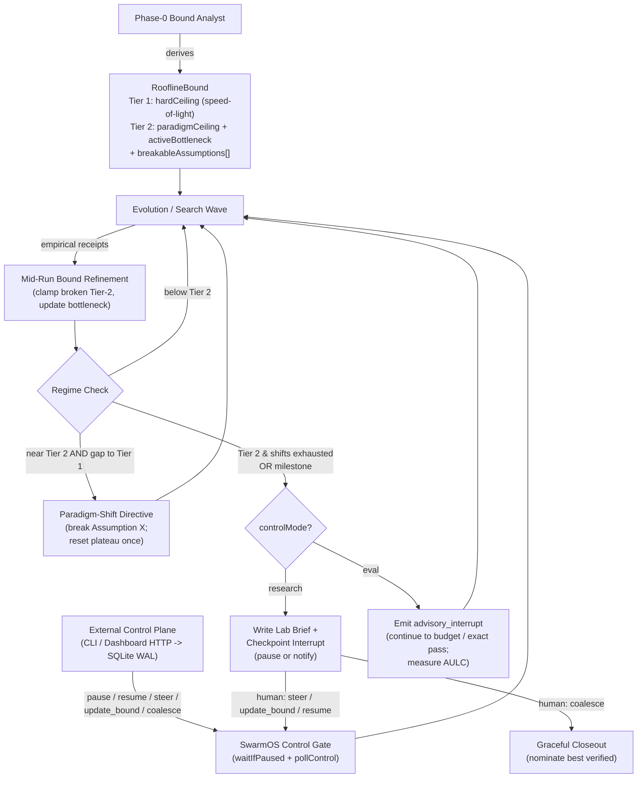

# Implementation Plan: Roofline Limit Ladder, Paradigm-Shift Steering & External Research Control Plane

> **Context for Main Synthesizer Agent:** This plan is one of 3 parallel side-chat plans created on top of `main` (`cf9287f`). See the **Conflict & Merge Surface** section below for exact files, line ranges, and cross-plan integration points (including direct touchpoints with [board-v3-reddit-native-and-planner-crosspost.md](file:///Users/ishaankundesu/Documents/one_piece/docs/plans/board-v3-reddit-native-and-planner-crosspost.md)) so you can reconcile all three plans cleanly.

---

## Goal Description

Redesign First-Principles Bounds and Swarm Stopping around how real open-ended research actually works (**punctuated equilibrium** toward physical/mathematical limits, supervised by a human researcher) while keeping automated evals clean and variance-free:

1. **Upgrade single-scalar `estimatedCeiling` → a 2-Tier Roofline Limit Ladder (`RooflineBound`):**
   - In Gen 14 on `vliw-kernel-opt`, `bound-analyst` correctly derived an idealized ALU speed-of-light roof (`33.6x`, ignoring memory gathers/loads/register pressure), while the swarm reached `18.3x` (vs the benchmark's `20.0x` realistic target). Because `bounds.ts` compared `bestScore / 33.6 >= 0.92` (`30.9x`), early stopping never fired (`checkpointsTriggered = 0`) and both seeds burned `~500k` extra tokens crawling from `17.6x–17.9x` to `18.3x`.
   - Worse, naive "diminishing returns" auto-stopping is dangerous on real frontier problems: you *need* to persist across flat plateaus when there is still a large gap to the physical limit, because breakthroughs require paradigm jumps.
   - **Solution:** Separate **Tier 1 (`hardCeiling`: physical/mathematical speed-of-light roof)** from **Tier 2 (`paradigmCeiling`: tightest bottleneck-constrained roof under the current algorithmic paradigm)**, paired with explicit **`activeBottleneck`** and **`breakableAssumptions`**—and allow **mid-run empirical bound refinement** from real profiling receipts.
2. **Decouple "approaching limit" from "kill the run" via Paradigm-Shift Steering:**
   - Reaching ~90% of **Tier 2 (`paradigmCeiling`)** while **Tier 1 (`hardCeiling`)** still has headroom triggers a **Paradigm-Shift Round** (explicitly instructing exploration/crossover workers to stop micro-tuning and break a named assumption separating Tier 2 from Tier 1) instead of silently quitting or wasting generations micro-scheduling.
3. **Split Execution Control Modes (`"research"` vs `"eval"`):**
   - **Research Mode (default for `one-piece run`):** Never silently kills a run on an LLM ceiling guess. Emits structured **Researcher Checkpoint Lab Briefs** (`<runDir>/checkpoints/brief-gen-<k>.md`) on phase transitions (Tier-2 saturation, multi-basin stall, or compute milestones), with selectable policy (`pause` vs `notify` vs `coalesce`).
   - **Eval Mode (default for `eval-lab`):** Never introduces LLM auto-stop variance on open-ended benchmarks. Runs cleanly to fixed budget (stopping early *only* on verifiable exact completion or a proven-tight hard ceiling), uses Tier-2 saturation to trigger paradigm shifts, emits non-blocking `advisory_interrupt` checkpoint telemetry, and guarantees closeout nomination via `AULC` evaluation.
4. **Add a First-Class External Control Plane (`pause` / `resume` / `steer` / `bound` / `coalesce`):**
   - Persist external commands in SQLite WAL (`control_commands` collection—zero schema migration), polled by `SwarmOS` at wave/turn/spawn boundaries and exposed via CLI (`one-piece pause|resume|steer|bound|coalesce|status`) and localhost Dashboard HTTP endpoints (`POST /api/runs/:id/control`).
   - Maintain a live `<runDir>/best-so-far.json` pointer on every newly accepted best finding, and make `coalesce` trigger graceful `workAbort` while preserving `closeoutAbort` so manual pausing/stopping *never* discards verified progress.



---

## User Review Required

> [!IMPORTANT]
> **Eval vs. Research Stopping Semantics:** Under this plan, `eval-lab` runs default to `controlMode: "eval"`, where Tier-2 saturation triggers **paradigm-shift steering** and logs non-blocking `advisory_interrupt` checkpoints rather than hard-stopping open-ended tasks early. Hard auto-stop in eval mode fires only on verifiable exact completion, a proven-tight hard bound (`isProvenHard: true`), or closeout reserve. Confirm this matches how you want `eval-lab` to measure anytime efficiency (`AULC`).

> [!WARNING]
> **Paused Wall-Clock Semantics:** When a human pauses a real research run (`one-piece pause <runId>`) to analyze artifacts for 20 minutes, should the OS **freeze `wallSeconds` countdown timers** while paused (recommended for human-in-the-loop research) or keep wall-clock ticking? The plan below proposes freezing the wall timer during `paused` state and recording `pausedMs` separately in run telemetry.

---

## Conflict & Merge Surface (For Main Synthesizer Agent)

Files and symbols this plan touches that overlap with the other 2 parallel side-chat plans (notably [board-v3-reddit-native-and-planner-crosspost.md](file:///Users/ishaankundesu/Documents/one_piece/docs/plans/board-v3-reddit-native-and-planner-crosspost.md) and the sibling closeout/straggler/refinery plan):

| Package / File | Symbols / Areas Touched | Overlap / Merge Notes for Synthesizer |
| --- | --- | --- |
| `packages/core/src/types.ts` | Add `RunControlCommand`, `RunControlStatus`, `ExecutionControlMode`, `BreakableAssumption`, `RooflineBoundSnapshot` | **Shared with Board v3 plan** (which modifies `BoardPost`). Disjoint types—merge cleanly without conflict. |
| `packages/core/src/state-machines.ts` | Add `transitionRunControl` (`running ↔ paused → coalescing`) & `transitionRooflineBound` (monotonic empirical clamping) | **Shared with Board v3 plan** (`transitionMarkOutdatedPost`/`transitionCrosspost`). Disjoint state machines—append cleanly. |
| `packages/core/src/store.ts` | Add `control_commands: RunControlCommandRecord` to `Documents` interface | Uses existing generic `docs` table in `SqliteStore`—no SQL migration needed. |
| `packages/core/src/events.ts` | Extend `bound.estimated` (optional `hardCeiling`, `paradigmCeiling`, `activeBottleneck`, `isRefinement`); extend `researcher.checkpoint` (`policy` adds `"pause"`/`"notify"`, `action` adds `"advisory_interrupt"`/`"paradigm_shift"`); add `bound.paradigm_shift`, `run.control_applied`, `run.paused`, `run.resumed` | **Shared with Board v3 plan** (`board.*` events) and likely Plan 3. All additions are additive fields/keys on `LifecycleEvents`. |
| `packages/core/src/topology.ts` | Add optional control-plane methods to `SwarmOsApi`: `controlMode`, `pollControl()`, `waitIfPaused()`, `requestCoalesce()`, `activeSteeringNotes()`, `latestBoundOverride()` | Optional methods on `SwarmOsApi` keep all existing mocks/tests backward compatible. |
| `packages/engine/src/bounds.ts` | **Primary owner.** Replace scalar `TheoreticalBound` with `RooflineBound` (keeping `estimatedCeiling` alias), add `refineRooflineBound()`, `writeResearcherBrief()`, and 4-way `CheckpointOutcome` (`continue` \| `paradigm_shift` \| `interrupt_researcher` \| `coalesce`) | **Direct integration point with Board v3 plan:** `bounds.ts` L178–L191 calls `os.board.publish({ kind: "bound_estimate", visibility: "global", ... })`. Reconcile with Board v3's `channel: "swarm"` / simplified post API when merging! |
| `packages/engine/src/topologies/evolution.ts` | `EvolutionTopologyOptions`, Phase-0 Roofline bound (`L75–L81`), Paradigm-Shift slot prompt injection (`L161–L185`), mid-run bound refinement & control-plane poll (`L243–L288`) | **HIGH-CONFLICT FILE with Board v3 plan** (which touches `crossoverPosts` board query and optional `hierarchicalIslands`). Both features compose cleanly: in island mode, island planners receive the same `RooflineBound` + `paradigm_shift` directives and poll `os.waitIfPaused()`. |
| `packages/engine/src/topologies/adaptive.ts` | Forward `controlMode`, `checkpointPolicy`, `onHumanCheckpoint` into delegates; update Jev pre-flight question `estimate_first_principles_bound` wording to mention Roofline guidance (not just stopping) | Minor additive forwarding in `AdaptiveTopologyOptions` and `runDelegateTopology()`. |
| `packages/engine/src/os.ts` | Add `controlMode` to `SwarmOsConfig`, attach `RunControlController` (SQLite WAL polling, pause/resume wall-timer freeze, live worker steer broadcast, graceful `requestCoalesce` -> `workAbort` preserving `closeoutAbort`), emit `<runDir>/best-so-far.json` on accepted best finding | **Shared hub with both other plans** (Board v3 removes `this.triage`; Plan 3 likely touches closeout/stragglers). Keep all control-plane logic encapsulated in a new `packages/engine/src/control-plane.ts` module to minimize diff lines in `os.ts`! |
| `packages/engine/src/index.ts` | Export new Roofline & control-plane types/helpers | Additive exports only. |
| `packages/cli/src/index.ts` | Add `status`, `pause`, `resume`, `steer`, `bound`, `coalesce` subcommands; add `--mode`, `--checkpoint-policy`, `--bound-analyst`, `--generations` to `cmdRun` | Low conflict risk—CLI subcommands are self-contained. |
| `packages/dashboard/src/index.ts` | Add `POST /api/runs/:id/control` and `GET /api/runs/:id/briefs`; include `controlState` & latest `bound` in `GET /api/runs/:id` | Low conflict risk—additive localhost routes. |
| `packages/eval-lab/src/contracts.ts`, `scorecard.ts`, `trajectory.ts`, `adapters/v2.ts`, `cli.ts` | Extend `mechanisms.meta` (`hardCeiling`, `paradigmCeiling`, `hardBoundValid`, `paradigmBoundCalibrationError`, `boundRefinements`, `paradigmShiftRounds`, `advisoryCheckpoints`); default `v2.ts` adapter to `controlMode: "eval"` | **Shared with Board v3 plan** (`mechanisms.board`) and likely Plan 3 (`mechanisms.integration`/`forest`). Changes are strictly scoped to `mechanisms.meta` and `v2.ts` topology options. |

---

## Proposed Changes

### 1. Core Types, Store Collection, Events & State Machines (`@one-piece/core`)

#### [MODIFY] [types.ts](file:///Users/ishaankundesu/Documents/one_piece/packages/core/src/types.ts)
Add explicit types for execution control mode, external control commands, and Roofline assumption tracking:
```ts
export type ExecutionControlMode = "eval" | "research";

export type RunControlStatus = "running" | "paused" | "coalescing";

export interface BoundOverride {
	readonly hardCeiling?: number | null;
	readonly paradigmCeiling?: number | null;
	readonly activeBottleneck?: string;
	readonly markAssumptionBroken?: string;
}

export type RunControlPayload = Exclusive<
	| { readonly type: "pause"; readonly reason?: string }
	| { readonly type: "resume"; readonly steeringNote?: string }
	| { readonly type: "steer"; readonly message: string; readonly targetAgentId?: string; readonly scope?: "next_wave" | "live_workers" | "both" }
	| { readonly type: "update_bound"; readonly override: BoundOverride; readonly reason?: string }
	| { readonly type: "coalesce"; readonly reason?: string }
>;

export type RunControlCommandRecord = {
	readonly id: string;
	readonly runId: string;
	readonly issuedBy: "cli" | "dashboard" | "callback" | "os";
	readonly createdAt: number;
	readonly acknowledgedAt?: number;
	readonly payload: RunControlPayload;
};
```

#### [MODIFY] [store.ts](file:///Users/ishaankundesu/Documents/one_piece/packages/core/src/store.ts)
- Add `control_commands: RunControlCommandRecord` to `Documents` (persisted automatically in the existing `docs` SQLite WAL table—zero schema migration, cross-process safe for CLI/Dashboard control).

#### [MODIFY] [state-machines.ts](file:///Users/ishaankundesu/Documents/one_piece/packages/core/src/state-machines.ts)
- Add **`transitionRunControl(state, cmd, now)`** encoding the strict external control state machine:
  - `running` → `paused` (via `pause`) or `coalescing` (via `coalesce`),
  - `paused` → `running` (via `resume`, carrying optional `steeringNote`) or `coalescing` (via `coalesce`),
  - `coalescing` is a **terminal absorbing state** (late `pause`/`resume`/`steer` commands cannot resurrect a coalescing run).
- Add **`clampRooflineBoundEmpirically(bound, observedScore)`**:
  - Guarantees that if an accepted verified finding empirically exceeds `paradigmCeiling` (or `hardCeiling`), the state transition marks the violated assumption as `"broken"`, records a violation/refinement event, and lifts `paradigmCeiling` to `null` (pending re-derivation) instead of leaving stale/impossible ratios.

#### [MODIFY] [events.ts](file:///Users/ishaankundesu/Documents/one_piece/packages/core/src/events.ts)
- Extend `LifecycleEvents` (fully backward-compatible with all 178 historical ledger runs):
  - `"bound.estimated"`: keep `estimatedCeiling` (set to `paradigmCeiling ?? hardCeiling`), add optional `hardCeiling?: number | null`, `paradigmCeiling?: number | null`, `isProvenHard?: boolean`, `activeBottleneck?: string`, `isRefinement?: boolean`.
  - `"bound.paradigm_shift"`: `{ generation: number; bestScore: number; paradigmCeiling: number; hardCeiling: number | null; targetAssumption: string; unlockHint: string }`.
  - `"researcher.checkpoint"`: widen `policy` to `"coalesce" | "interactive" | "pause" | "notify"`, add optional `hardCeiling?: number | null`, `paradigmCeiling?: number | null`, `briefPath?: string`, `controlMode?: ExecutionControlMode`.
  - `"run.control_applied"`: `{ commandId: string; type: RunControlPayload["type"]; issuedBy: string; nextState: RunControlStatus; detail?: string }`.
  - `"run.paused"`: `{ reason: string }` and `"run.resumed"`: `{ pausedMs: number; steeringNote?: string }`.

#### [MODIFY] [topology.ts](file:///Users/ishaankundesu/Documents/one_piece/packages/core/src/topology.ts)
- Add optional control-plane surface to `SwarmOsApi`:
  - `readonly controlMode?: ExecutionControlMode;`
  - `pollControl?(): { readonly state: RunControlStatus; readonly newSteeringNotes: readonly string[]; readonly boundOverride?: BoundOverride };`
  - `waitIfPaused?(signal?: AbortSignal): Promise<"running" | "coalescing" | "aborted">;`
  - `requestCoalesce?(reason?: string): void;`
  - `activeSteeringNotes?(): readonly string[];`

---

### 2. Roofline Limit Ladder & External Control Plane (`@one-piece/engine`)

#### [MODIFY] [bounds.ts](file:///Users/ishaankundesu/Documents/one_piece/packages/engine/src/bounds.ts)
1. **Replace scalar `TheoreticalBound` with `RooflineBound`** (exporting `type TheoreticalBound = RooflineBound` for backward compatibility):
   ```ts
   export interface BreakableAssumption {
   	readonly id: string;
   	readonly assumption: string;
   	readonly unlockHint: string;
   	readonly tier: "paradigm" | "hard";
   	readonly status: "active" | "attempted" | "broken" | "confirmed_hard";
   }

   export interface RooflineBound {
   	readonly metricName: string;
   	readonly higherIsBetter: boolean;
   	/** Tier 1: Physical / mathematical speed-of-light limit (hard roof). */
   	readonly hardCeiling: number | null;
   	/** True only if hardCeiling is an exact mathematical/spec limit (e.g. score=1.0 or proven exact floor). */
   	readonly isProvenHard: boolean;
   	/** Tier 2: Bottleneck-constrained ceiling under the current algorithmic paradigm. */
   	readonly paradigmCeiling: number | null;
   	/** Backwards-compatible alias: paradigmCeiling ?? hardCeiling. */
   	readonly estimatedCeiling: number | null;
   	readonly activeBottleneck: string;
   	readonly derivationSummary: string;
   	readonly keyAssumptions: string[];
   	readonly breakableAssumptions: readonly BreakableAssumption[];
   	/** Fraction of Tier-2 paradigmCeiling that triggers a paradigm-shift directive (default 0.90). */
   	readonly paradigmShiftFraction: number;
   	/** Fraction of Tier-1 hardCeiling that triggers Researcher Checkpoint / completion (default 0.96). */
   	readonly stoppingFraction: number;
   	readonly confidence: number;
   	readonly revision: number;
   }
   ```
2. **Update Phase-0 `BOUND_SCHEMA` and `estimateFirstPrinciplesBound()` prompt:**
   - Instruct `bound-analyst` to explicitly separate:
     - `hard_ceiling` (absolute physical/mathematical speed-of-light bound, e.g. pure compute/ALU or information-theoretic limit),
     - `paradigm_ceiling` (tightest practical roof accounting for the dominant real bottleneck—memory gathers/bandwidth, control flow, synchronization, register pressure—on the current algorithmic approach),
     - `active_bottleneck` (concise name of what caps `paradigm_ceiling`), and
     - `breakable_assumptions[]` (each with `id`, `assumption`, `unlock_hint`, `tier`) explaining *what must change structurally* to jump from `paradigm_ceiling` toward `hard_ceiling`.
   - *(Merge note for Board v3)*: Publish the bound summary to the shared global board (`channel: "swarm"` under Board v3, or `visibility: "global"` on current Board v2).
3. **Add `refineRooflineBound(os, { bound, bestScore, recentFindings, negativeMemory, signal })`:**
   - **Deterministic step (0 tokens):** First runs `clampRooflineBoundEmpirically(bound, bestScore)`. If an accepted finding empirically beats `paradigmCeiling`, marks the corresponding paradigm assumption `"broken"` and logs a refinement.
   - **Optional LLM profiling re-derivation** (triggered only when a paradigm ceiling was broken OR after a paradigm-shift round succeeds with new empirical telemetry): spawns a 1-turn read-only `bound-analyst` with the winning diff/benchmark output to tighten `paradigmCeiling` & `activeBottleneck` from real measurements, emitting `bound.estimated` with `isRefinement: true`.
4. **Upgrade `evaluateResearcherCheckpoint()` to return a 4-way `CheckpointOutcome`:**
   ```ts
   export type CheckpointPolicy = "coalesce" | "interactive" | "pause" | "notify";

   export type CheckpointOutcome = Exclusive<
   	| { readonly action: "continue"; readonly reason: string; readonly steeringNote?: string }
   	| {
   		readonly action: "paradigm_shift";
   		readonly reason: string;
   		readonly targetAssumption: BreakableAssumption;
   		readonly directive: string;
   		readonly remainingGapToHard: number | null;
   	}
   	| {
   		readonly action: "interrupt_researcher";
   		readonly trigger: ResearcherCheckpointReport["trigger"];
   		readonly reason: string;
   		readonly briefPath: string;
   		readonly pauseRun: boolean;
   		readonly steeringNote?: string;
   	}
   	| {
   		readonly action: "coalesce";
   		readonly trigger: ResearcherCheckpointReport["trigger"];
   		readonly reason: string;
   		readonly briefPath?: string;
   	}
   >;
   ```
   - **Decision logic (strictly separates Tier-2 saturation from hard stopping and `eval` vs `research`):**
     1. **Exact / Proven-Hard Completion:** If `bound.isProvenHard && hardCeiling` and `ratioToHard >= stoppingFraction` → `"coalesce"` in both modes.
     2. **Tier-2 Saturation with Open Tier-1 Headroom:** If `paradigmCeiling` exists, `ratioToParadigm >= bound.paradigmShiftFraction`, there is meaningful gap to `hardCeiling` (or `hardCeiling === null`), AND there is an un-attempted `active` paradigm `BreakableAssumption` → return **`"paradigm_shift"`** pointing at that assumption (emits `bound.paradigm_shift`).
     3. **Post-Shift Saturation / Multi-Basin Stall / Jev Checkpoint / Compute Milestone:**
        - Generate a structured 1-page Markdown **Lab Brief** via `writeResearcherBrief(os.runDir, report)` (`<runDir>/checkpoints/brief-gen-<k>.md`) containing: current best score + verified artifact path, Tier 1 & Tier 2 Roofline table, remaining assumptions vs dead-ends tried, spend so far, and exact `one-piece control` commands.
        - **In `"eval"` mode:** Unless policy was explicitly overridden for a stopping test, emit `researcher.checkpoint` with `action: "advisory_interrupt"` and return **`"continue"`** (never auto-kill an open-ended eval run!).
        - **In `"research"` mode:**
          - `"interactive"` (callback provided): invoke `onHumanCheckpoint(report)` (supporting `coalesce`, `continue` + `steeringNote`, and `updatedBound`).
          - `"pause"`: emit `researcher.checkpoint(action="pause")` and return `"interrupt_researcher"` with `pauseRun: true` (OS enters `paused` state until external CLI/Dashboard `resume`/`steer`/`coalesce` arrives).
          - `"notify"`: emit `researcher.checkpoint(action="notify")` and return `"interrupt_researcher"` with `pauseRun: false` (keeps searching asynchronously while alerting the user via Dashboard SSE / CLI log).
          - `"coalesce"`: return `"coalesce"`.

#### [NEW] [control-plane.ts](file:///Users/ishaankundesu/Documents/one_piece/packages/engine/src/control-plane.ts)
A cohesive, zero-bloat controller owned by `SwarmOS` so `os.ts` diffs remain small and conflict-free:
- Polls `store.list("control_commands", { runId })` for unacknowledged commands (`acknowledgedAt === undefined`), ordered by `createdAt`.
- Applies each command through `transitionRunControl(...)`, marks `acknowledgedAt = now` in `store`, and emits `run.control_applied`.
- Tracks `pausedStartedAt` & cumulative `totalPausedMs` so wall-clock timers can pause cleanly while a human analyzes a Lab Brief.
- Implements `waitIfPaused(signal)` with a low-overhead 500 ms poll loop (plus instant wakeup for in-process callbacks) that returns `"running"`, `"coalescing"`, or `"aborted"`.
- Exposes `writeBestSoFarPointer(runDir, payload)` to atomically update `<runDir>/best-so-far.json` whenever a higher-scoring verified finding is accepted.

#### [MODIFY] [os.ts](file:///Users/ishaankundesu/Documents/one_piece/packages/engine/src/os.ts)
- Add `controlMode?: ExecutionControlMode` to `SwarmOsConfig` (default `"research"` in CLI, `"eval"` in `eval-lab`).
- Instantiate `private readonly control = new RunControlController(...)` and wire `pollControl()`, `waitIfPaused()`, `requestCoalesce()`, `activeSteeringNotes()` on `SwarmOS`.
- **`requestCoalesce(reason)`:** Aborts `this.workAbort` (cleanly winding down active workers) while leaving `this.closeoutAbort` intact so `CloseoutController.finalize()` drains verifications and nominates the best verified deliverable.
- **Wall-budget pause awareness:** On `run.paused`, cancel active `wallBudgetState` timers and store remaining wall ms; on `run.resumed`, re-arm `reserveTimer` and `hardTimer` for the remaining duration (emitting `pausedMs`).
- **Live worker steering:** When a `steer` command arrives with `scope: "live_workers" | "both"`, forward `message` to matching `activeHandles` via `handle.steer(msg)` AND record it in `activeSteeringNotes` for subsequent waves.
- **Live frontier snapshot:** On `finding.verdict` with `verdict === "accepted"`, if the finding improves the run's best verified score, write `<runDir>/best-so-far.json` (`findingId`, `revision`, `score`, `artifactSha256`, `snapshotDir`, `updatedAt`).

#### [MODIFY] [evolution.ts](file:///Users/ishaankundesu/Documents/one_piece/packages/engine/src/topologies/evolution.ts)
- Update `EvolutionTopologyOptions` to accept `controlMode?: ExecutionControlMode`, `initialBound?: RooflineBound`, `checkpointPolicy?: CheckpointPolicy` (defaulting to `"pause"` in `"research"` mode if interactive, or `"notify"` for detached research, and `"coalesce"`/`advisory` in `"eval"` mode).
- At the top of each generation loop (`L82`):
  1. Call `const ctrl = await os.waitIfPaused?.(signal)` and `os.pollControl?.()`; if `ctrl === "coalescing"` break cleanly into nomination.
  2. Apply any `boundOverride` from external `update_bound` commands and append any `newSteeringNotes` to `activeSteeringNote`.
- **Paradigm-Shift Round support (`L161–L185`):**
  - Replace single-line `boundHint` with a concise Roofline summary (`Tier-1 Hard Ceiling`, `Tier-2 Paradigm Ceiling`, `Active Bottleneck`).
  - When `activeParadigmShift` is active for this generation:
    - Mark slots `>= 1` (`[PARADIGM-SHIFT]`) with an explicit directive: *"Current best (`X`) is near Tier-2 bottleneck roof (`Y`, capped by `activeBottleneck`). Do NOT micro-optimize the existing schedule. Break assumption `<id>`: `<assumption>`. Unlock direction: `<unlockHint>`."*
    - Keep Slot `0` as a guard/exploit or crossover slot so we never regress the incumbent.
    - Mark that `BreakableAssumption` as `"attempted"` after the generation finishes (or `"broken"` if the new score clears `paradigmCeiling`!).
- **Post-generation refinement & checkpoint (`L243–L288`):**
  1. Run `refineRooflineBound(...)` (zero-token clamp every gen; optional 1-turn re-derivation only if Tier 2 was broken).
  2. Run `evaluateResearcherCheckpoint(...)`:
     - On `"paradigm_shift"`: set `activeParadigmShift`, reset `staleGens = 0` once for the pivot, and continue!
     - On `"interrupt_researcher"`: if `pauseRun`, trigger OS pause and await `os.waitIfPaused(signal)` right before the next generation!
     - On `"coalesce"`: emit `phase.changed` -> `"researcher-coalesce"` and `break`.
  3. On `staleGens >= plateauLimit`: in `"research"` mode with an un-exhausted Tier-1 gap, emit a Researcher Checkpoint Brief instead of silently quitting; in `"eval"` mode, break only after paradigm shifts have been attempted or if no Tier-1 headroom remains.

#### [MODIFY] [adaptive.ts](file:///Users/ishaankundesu/Documents/one_piece/packages/engine/src/topologies/adaptive.ts)
- Forward `controlMode`, `checkpointPolicy`, `onHumanCheckpoint` through `AdaptiveTopologyOptions` → `runDelegateTopology()`.
- Update Jev pre-flight question `estimate_first_principles_bound` wording so it asks whether deriving a **2-tier Roofline bound (hard ceiling + bottleneck paradigm ceiling)** will guide paradigm shifts and search steering (not merely early stopping).

---

### 3. External Control CLI & Local Dashboard (`@one-piece/cli`, `@one-piece/dashboard`)

#### [MODIFY] [index.ts](file:///Users/ishaankundesu/Documents/one_piece/packages/cli/src/index.ts)
- Add new CLI flags to `cmdRun`:
  - `--mode research|eval` (default `research`)
  - `--checkpoint-policy pause|notify|coalesce` (default `notify` for non-TTY, `pause` when `--interactive` is set)
  - `--bound-analyst` & `--generations unbounded|<n>` (forwarded into `createTopology`)
  - Log `bound.estimated`, `bound.paradigm_shift`, `researcher.checkpoint`, `run.paused`, `run.resumed`, `run.control_applied` events cleanly to stdout.
- Add external control commands (operating on the shared project `SqliteStore` in WAL mode, auto-selecting the single active `running` run if `<runId>` is omitted):
  - `one-piece status [runId]` — prints run status, control state, elapsed vs paused time, current best verified finding (`best-so-far.json`), latest Tier-1/Tier-2 Roofline bound, and latest Lab Brief path.
  - `one-piece pause [runId] [--reason "..."]`
  - `one-piece resume [runId] [--steer "..."]`
  - `one-piece steer [runId] "<message>" [--agent <id>] [--live]`
  - `one-piece bound [runId] [--hard <n>] [--paradigm <n>] [--bottleneck "..."] [--break-assumption <id>]`
  - `one-piece coalesce [runId] [--reason "..."]` — graceful stop & ship best verified deliverable.

#### [MODIFY] [index.ts](file:///Users/ishaankundesu/Documents/one_piece/packages/dashboard/src/index.ts)
- Add localhost-only (`127.0.0.1`) control endpoints:
  - `POST /api/runs/:id/control` — validates a `RunControlPayload` and writes a `RunControlCommandRecord` (`issuedBy: "dashboard"`) into `store.put("control_commands", ...)`, returning `202 Accepted` + command ID.
  - `GET /api/runs/:id/briefs` — lists & serves Markdown Lab Briefs from `<runDir>/checkpoints/` (if `runDir` is recorded on `run`).
- Include `controlCommands` (recent 20) and `latestBound` in `GET /api/runs/:id`.

---

### 4. Scorecard v2, Trajectory & Eval Mode Alignment (`@one-piece/eval-lab`)

#### [MODIFY] [contracts.ts](file:///Users/ishaankundesu/Documents/one_piece/packages/eval-lab/src/contracts.ts) & [scorecard.ts](file:///Users/ishaankundesu/Documents/one_piece/packages/eval-lab/src/scorecard.ts)
- Extend `MetaControlTelemetry` cleanly (preserving 100% compatibility with Gens 1–14):
  - `hardCeiling?: number | null`
  - `paradigmCeiling?: number | null`
  - `hardBoundValid?: boolean` (true when achieved score never exceeded a claimed `hardCeiling` — flags invalid/over-tight "hard" bounds!)
  - `paradigmBoundCalibrationError?: number` (relative error of `paradigmCeiling` vs `prepared.theoreticalCeiling`)
  - `boundRefinements?: number`
  - `paradigmShiftRounds?: number`
  - `advisoryCheckpoints?: number`
- Keep `estimatedCeiling` populated from `paradigmCeiling ?? hardCeiling ?? estimatedCeiling` so existing charts and `boundCalibrationError` continue smoothly across generations.

#### [MODIFY] [adapters/v2.ts](file:///Users/ishaankundesu/Documents/one_piece/packages/eval-lab/src/adapters/v2.ts) & [cli.ts](file:///Users/ishaankundesu/Documents/one_piece/packages/eval-lab/src/cli.ts)
- Pass `controlMode: "eval"` by default in `createV2Adapter` (`SwarmOS.create` and `topologyOptions`), while still honoring explicit `--checkpoint-policy` overrides from `eval-lab run`.
- Add `paradigmShiftYield` (fraction of `bound.paradigm_shift` rounds followed by a score improvement) and `hardBoundValidityRate` to [trajectory.ts](file:///Users/ishaankundesu/Documents/one_piece/packages/eval-lab/src/trajectory.ts) generation summaries.

---

## Open Questions (For Final Synthesis with Other 2 Plans)

> [!NOTE]
> 1. **Board v3 publish contract (`bounds.ts`):** When synthesizing with [board-v3-reddit-native-and-planner-crosspost.md](file:///Users/ishaankundesu/Documents/one_piece/docs/plans/board-v3-reddit-native-and-planner-crosspost.md), `bounds.ts` should publish `RooflineBound` updates and Lab Brief pointers using the new Reddit/X `channel: "swarm"` + `board_edit` (marking older bound estimates outdated on mid-run refinement) rather than legacy `kind: "bound_estimate"`.
> 2. **Wall-clock pause vs. external timeout:** Confirm whether `one-piece pause` should freeze `wallSeconds` indefinitely in `"research"` mode (recommended, with an optional `--max-pause-minutes` safety cap) while `"eval"` mode keeps wall-clock strictly unpausable for benchmark fairness.
> 3. **Other topologies using `waitIfPaused()` / `pollControl()`:** This plan wires the full Roofline + paradigm-shift loop into `evolution.ts` (and `adaptive.ts`) and wires OS-level `waitIfPaused` / `requestCoalesce` into `SwarmOS.spawnWorker()`. Should we also add explicit wave-boundary `waitIfPaused()` checks in `elastic-phase.ts`, `pull-refinery.ts`, and `recursive-planners.ts` in the same cycle (coordinating with Plan 3 if Plan 3 edits `pull-refinery.ts` / `elastic-phase.ts`)?

---

## Verification Plan

### Automated Tests
1. **Typecheck & compile-time state-machine proofs** (adding `@ts-expect-error` proofs for `RunControlCommand`, `transitionRunControl` absorbing `coalescing` state, and 4-way `CheckpointOutcome`):
   ```bash
   npm run typecheck
   ```
2. **Unit & integration test suite** (extending `packages/engine/test/unbounded-evolution-and-adaptive.test.ts` and `packages/eval-lab/test/pillar1-pillar2.test.ts` + adding `packages/engine/test/control-plane.test.ts`):
   - Roofline `parseBoundJson` parses 2-tier `hard_ceiling` + `paradigm_ceiling` + `breakable_assumptions` and remains backward-compatible with legacy single-ceiling JSON.
   - Reaching `>= 0.90` of `paradigmCeiling` while `hardCeiling` has headroom triggers `"paradigm_shift"` (not `"coalesce"`), injects the targeted assumption-breaking directive into Gen `k+1`, and resets `staleGens` once.
   - Empirically beating `paradigmCeiling` automatically marks that assumption `"broken"` and emits a bound refinement.
   - `"eval"` mode emits non-blocking `advisory_interrupt` without prematurely killing an open-ended run; `"research"` mode with `checkpointPolicy: "pause"` writes a valid Lab Brief and pauses until an external `resume` / `steer` / `coalesce` command is written to `Store`.
   - External `coalesce` command triggers `workAbort` while preserving `closeoutAbort` and auto-nominates the best verified finding (`best-so-far.json` matches final nomination).
   - `transitionRunControl` enforces `coalescing` as an absorbing terminal state; wall-clock timer freezes cleanly during `paused` state and resumes with exact remaining ms.
   ```bash
   npm test
   ```
3. **Harness fault/chaos/Seatbelt verification:**
   ```bash
   npm run verify:harness -- --skip-typecheck
   ```

### Live Eval & Manual Control-Plane Verification
1. **Live `vliw-kernel-opt` Gen 15 verification** (`adaptive-n4`, `--generations unbounded --bound-analyst`, `800k` tok, `240s` wall, seeds `1–2`):
   - Verify `bound-analyst` emits a realistic Tier-2 `paradigmCeiling` (near `~19–22x`, `paradigmBoundCalibrationError < 0.20`) alongside Tier-1 `hardCeiling` (`~26–33.6x`, `hardBoundValid === true`).
   - Verify that upon hitting `~17.6x–18.0x`, `bound.paradigm_shift` fires and directs workers to attack an explicit bottleneck assumption (e.g., deeper tree-level broadcasts / gather elimination), and check whether Gen 15 beats Gen 14's `18.32x` mean or improves `AULC`.
2. **Manual Interactive Research Control Smoke Test:**
   - Start a real run with `one-piece run "..." --topology evolution --mode research --checkpoint-policy pause --bound-analyst --dashboard`.
   - From a second terminal (and via `POST http://127.0.0.1:4747/api/runs/<id>/control`), run `one-piece status`, `one-piece pause`, inspect `<runDir>/best-so-far.json` and `<runDir>/checkpoints/brief-*.md`, send `one-piece steer <id> "..."` + `one-piece resume`, and finish cleanly with `one-piece coalesce`—confirming graceful nomination of the best verified artifact.
